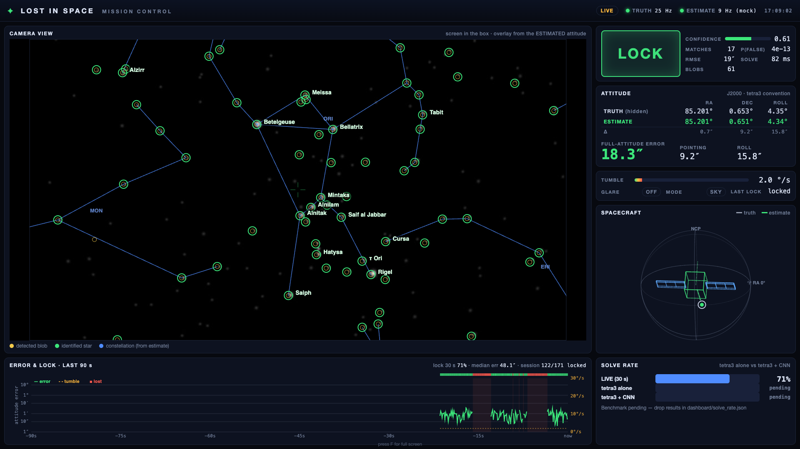

# Lost in Space

A star tracker you can try to break. A tumbling, sensor-blinded spacecraft works out which way it is
pointing from camera pixels alone. A small neural network (**StarNet**) finds stars inside motion-blur
streaks and glare, and a classic solver (**tetra3**) matches them against the catalog.



## The problem

When a spacecraft's computer resets, it no longer knows its orientation. Real satellites recover by
photographing the stars and matching the pattern to a catalog: the *lost-in-space problem*. But
spacecraft usually get lost because something went wrong, and then they are often tumbling. Every star
smears into a streak, and standard star-finding software expects neat dots.

Filmed through a simulated webcam at 20°/s tumble, the best tetra3 setup solves **51%** of frames. With
StarNet in front of it, the same solver solves **97%**.

## How it works

```
sky simulator ──► screen ──► camera ──► StarNet / blob finder ──► tetra3 ──► attitude ──► dashboard
   (sim/)                    (camera/)        (ml/)                                       (dashboard/)
     ▲  hidden truth over UDP ────────────────────────────────────────────────────────────────┘
     └─ flare / tumble commands ◄── console (firmware/ + bridge/)
```

- **Sky simulator** (`sim/`) renders the real sky (stars to magnitude 5.5) at a hidden attitude, with
  motion blur, glare, sensor noise and hot pixels. Only the simulator and the dashboard know the truth.
- **Camera side** (`camera/`) captures the screen with a webcam, maps it back to screen pixels through a
  calibration homography, and solves. A synthetic webcam (`camera/fakecam.py`) lets you test without
  hardware. A frame is good with ≥ 8 matched stars and false-match probability ≤ 1e-6; LOCK needs 10
  good frames in a row.
- **StarNet** (`ml/`) is a 470k-parameter, fully convolutional CenterNet-style network trained on
  freshly rendered, exactly labelled frames. It outputs star / planet / hot-pixel heatmaps with
  sub-pixel offsets, so junk never reaches the solver.
- **Console** (`firmware/`, `bridge/`): an Arduino Uno with Grove parts (button, knob, OLED, buzzer, LED,
  two servos). Hit **Solar Flare** to blind the sensor and reset the attitude; turn the knob for up to
  20°/s tumble. A virtual console web page stands in when no board is connected.
- **Dashboard** (`dashboard/`): a stdlib Python server pushing Server-Sent Events to a full-screen page.
  It shows the solved camera frame with identified stars and constellation lines, the hidden truth,
  pointing error in arcseconds, lock state and history. Voice callouts (`voice/`) announce lock, flare
  and recovery.

## Quick start

Requires Python 3 and macOS or Linux.

```bash
python3 -m venv .venv
```

```bash
.venv/bin/pip install numpy scipy opencv-python pillow pyserial cedar-solve
```

```bash
.venv/bin/pip install torch matplotlib pandas
```

(The last line is only needed for StarNet and the benchmarks.)

Run the whole demo with no camera and no board:

```bash
demo/fake_demo.sh --open
```

This starts the simulator, the solver, the dashboard on http://localhost:8080 and the virtual console on
http://localhost:8081. Press **Space** or click **FLARE** to blind the tracker and watch it re-lock;
drag the knob to add tumble. Useful flags:

| flag | effect |
|---|---|
| `--starnet` | use the StarNet CNN as the star finder |
| `--classic` | plain tetra3 blob finder (loses lock near 5°/s) |
| `--board` | use the real Arduino console over USB |
| `--full` | simulator full screen instead of a window |
| `--no-web` | keyboard only (`f` = flare, `0`–`1023` = knob, `q` = quit) |

Dashboard only, with synthetic feeds:

```bash
.venv/bin/python -m dashboard --mock --open
```

## Results

Frames are filmed by the synthetic webcam (`camera/fakecam.py`: keystone, defocus, LCD black glow,
vignetting, sensor noise, JPEG), which StarNet never saw in training. The camera image is warped back to
screen pixels before detection. Correct = attitude within 1° of truth, 100 frames per cell. Full table
in [ml/out/benchmark_simcam.md](ml/out/benchmark_simcam.md).

| tumble (°/s) | 0 | 2 | 5 | 10 | 15 | 20 |
|---|---:|---:|---:|---:|---:|---:|
| tetra3, tuned, no glare | 100 | 100 | 100 | 100 | 84 | 51 |
| **StarNet → tetra3, no glare** | **100** | **100** | **100** | **100** | **98** | **97** |
| tetra3, tuned, glare | 100 | 100 | 100 | 98 | 72 | 61 |
| **StarNet → tetra3, glare** | **99** | **100** | **100** | **99** | **100** | **96** |

- Up to 10°/s both methods are at 98–100%. StarNet's lead shows during fast tumble: +14 to +46 points
  at 15–20°/s.
- Warping the image before detection matters: running StarNet on raw camera pixels and warping only
  the centroids drops it to 8–18% with glare.

## Repository layout

| folder | what |
|---|---|
| [`sim/`](sim/) | sky renderer (`sky.py`) and live simulator (`live.py`); truth out over UDP |
| [`camera/`](camera/README.md) | webcam capture, calibration, live solve, synthetic webcam |
| [`ml/`](ml/README.md) | StarNet model, training, detection API, benchmarks |
| [`dashboard/`](dashboard/README.md) | mission-control web dashboard |
| [`bridge/`](bridge/README.md) | serial bridge to the console and the virtual console page |
| [`firmware/`](firmware/PROTOCOL.md) | Arduino console sketch and serial/UDP protocol |
| [`voice/`](voice/README.md) | voice callout generation (ElevenLabs) |
| [`docs/`](docs/WIRING.md) | console wiring |
| [`demo/`](demo/) | one-command demo and a standalone tetra3 example |
| [`data/`](data/) | star catalog, constellation lines, star names, tetra3 database |

Each folder's README covers its own commands and options.

## With real hardware

Show the simulator on a screen inside a dark box, point a webcam at it, then:

```bash
.venv/bin/python -m sim.live
```

```bash
.venv/bin/python -m camera.calibrate --index 0
```

```bash
.venv/bin/python -m camera.solve_live --index 0 --show
```

```bash
.venv/bin/python -m dashboard --open
```

Re-run `calibrate` whenever the camera or screen moves. On macOS, the terminal needs camera permission
(System Settings → Privacy & Security → Camera). See [camera/README.md](camera/README.md) and
[bridge/README.md](bridge/README.md) for the console.

## Credits

- [tetra3 / cedar-solve](https://github.com/smroid/cedar-solve) for star identification and attitude.
- Star data and constellation lines from [d3-celestial](https://github.com/ofrohn/d3-celestial)
  (see `data/LICENSE.d3-celestial`) and the Yale Bright Star Catalog.
- Voice by ElevenLabs.
