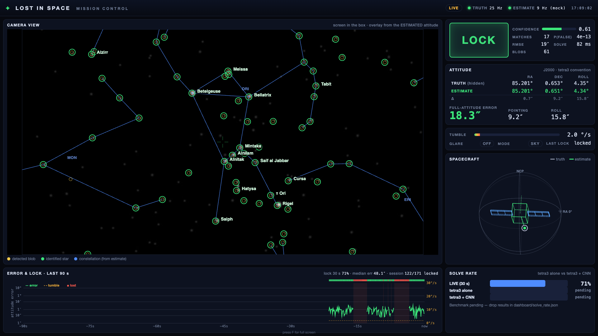

# Mission-control dashboard

What the judges watch: the hidden truth next to our estimate, live.

A small Python server (stdlib HTTP + Server-Sent Events, using only numpy/scipy/opencv from the venv)
listens to the UDP feeds. It works out the errors, the lock state and the overlays, and serves a
full-screen page on **http://localhost:8080**. You don't need to install anything new.



## Run it

From the repo root:

```bash
# demo / testing with nothing else running: both feeds are synthesised
.venv/bin/python -m dashboard --mock --open

# real sim, fake estimates (camera solve not ready yet)
.venv/bin/python -m sim.live --window          # terminal 1
.venv/bin/python -m dashboard --mock-est --open # terminal 2

# the real thing: sim.live -> truth 5005, camera.solve_live -> estimates 5008
.venv/bin/python -m sim.live                     # on the box display
.venv/bin/python -m camera.solve_live --index 0  # (branch claude/admiring-pare-664184)
.venv/bin/python -m dashboard --open
```

`--open` launches Chrome in kiosk mode (full screen, no browser chrome). Quit it with ⌘Q. If you
open the page any other way, press **F** for full screen. Other flags: `--port`, `--truth-port`,
`--est-port`, `--seed`, and `--solve-rate FILE`.

To push mock packets through the real UDP path (the dashboard runs with no `--mock` flag):

```bash
.venv/bin/python -m dashboard.mock               # truth 5005 @30 Hz + estimates 5008 @10 Hz
.venv/bin/python -m dashboard.mock --no-truth    # or --no-est: check the "no signal" states
```

## What's on screen

| Panel | Source |
|---|---|
| **Camera view** | The star field the box screen is showing, re-rendered from truth with `sim.sky` (motion blur from consecutive truth packets, glare when it's on). Drawn on top: yellow = detected centroids from the estimate packet; green rings = catalogue stars that land on a centroid when projected with the **estimated** attitude; star names from `data/starnames.json`; blue constellation lines from `data/constellations.lines.json`, also projected with the **estimated** attitude. If the lines sit on the stars, the solve is right. |
| **Lock badge** | `LOCK` = latest estimate is LOCK. `LOST` = no lock for under 3 s. `SEARCH` = no lock for 3 s or more. `NO SIGNAL` = no estimate packets for 2 s. `CALIBRATING` = sim is showing the checkerboard. Also shows confidence, matches, false-match probability, RMSE, solve time and blob count. |
| **Attitude** | Truth vs estimate RA/Dec/Roll. The Δ row is on-sky arcsec. Full-attitude error is the angle of `R_trueᵀ·R_est`, so it includes roll. Pointing is the boresight angle; roll is the roll difference. |
| **Tumble / glare / mode** | From the truth feed. |
| **Spacecraft** | A 3D wireframe on the celestial sphere. The dashed ghost is truth and the solid green craft is the estimate. The dot is where the camera points. |
| **Error & lock, last 90 s** | Full-attitude error on a log scale (1″ to 40°), the tumble rate (dashed, right axis), and a lock strip with red bands where the lock was lost. |
| **Solve rate** | Reads `dashboard/solve_rate.json` every 2 s. Until that file exists it shows the live 30 s lock rate and "pending" for tetra3 alone / tetra3 + CNN. The format is in `solve_rate.example.json`; copy it and fill in the real benchmark. |

Truth used for errors: when the estimate packet carries the `truth` it was paired with (camera.solve_live
does this), that truth is used, so tumble latency doesn't show up as error. Otherwise the latest truth
packet is used.

## Missing inputs

Each feed is independent. With no truth you still get the detections and overlay, plus the truth that is
embedded in the estimate packets. With no estimates you get the sky and a `NO SIGNAL` badge. With
neither you get a big NO SIGNAL. If the server itself dies, the page says "server offline" and
reconnects on its own. If a UDP port is already taken, the feed chip shows `PORT BUSY`.

## Tested

The screenshots are in `screenshots/`, all taken at 1920×1080 with headless Chrome using
`?poll` (polling instead of SSE, so headless Chrome can finish the page):

- `0_mock.png`: `--mock`, 15 °/s tumble + glare, lock lost
- `1_lock_simlive.png` to `4_calib.png`: `sim.live --window` + `--mock-est`. Lock, then right after a
  flare (SEARCH), then 18 °/s + glare (LOST, streaks), then calibration mode
- `5_no_signal.png`: sim.live killed
- `6_truth_missing.png`: `dashboard` + `dashboard.mock --no-truth`
- `7_live_udp_mock.png`: `dashboard` + `dashboard.mock` over real UDP
- `8_real_solve_live_sim.png`: `dashboard` + the real `camera.solve_live --sim`, run from its own
  worktree, unmerged. Real tetra3 at 6″ full-attitude error, which checks the 5008 packet format

Not tested: a real webcam. The camera view is always the sim re-render, not the webcam image,
because solve_live owns the camera. Also not tested: the `--open` kiosk launch on the demo laptop.
The glare corner in the re-render is fixed to the bottom right, because the truth packet doesn't
say which corner sim.live picked.
