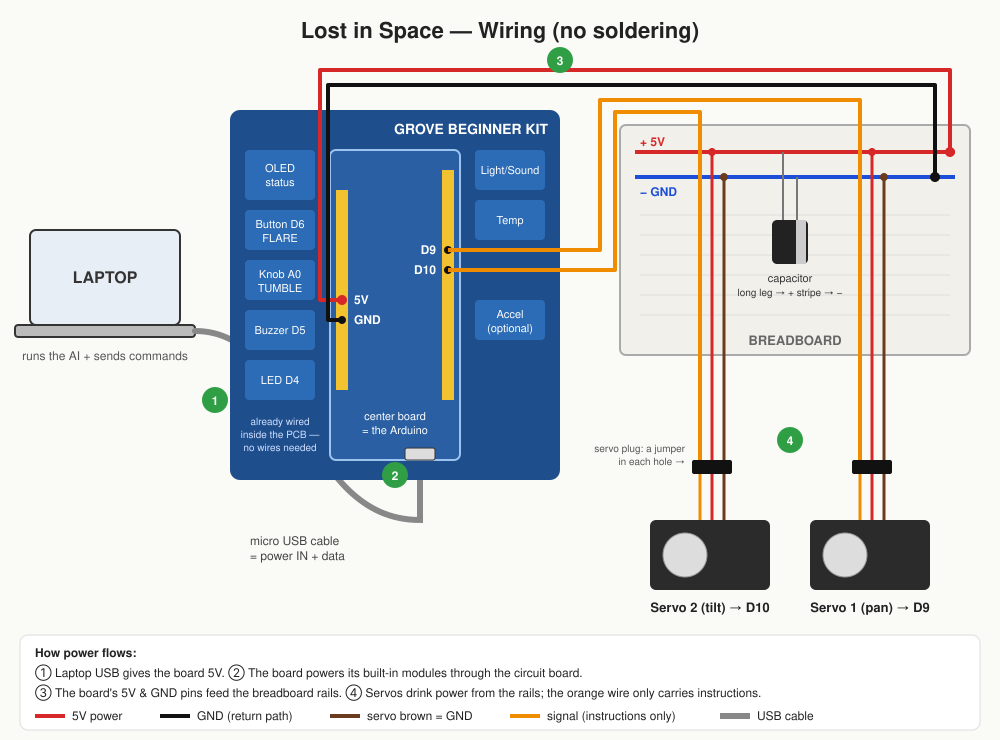

# Wiring Guide (beginner, no soldering)



## How does any of this get power?

Think of electricity like water in pipes. It needs a **source**, a **path out**, and a **path back**.

1. **Laptop → board.** The micro USB cable carries **5V power** *and* data from the laptop into the Grove kit's center board (that center board *is* the Arduino).
2. **Board → built-in modules.** The button, knob, OLED, buzzer, LED are already connected to the board **through copper traces inside the blue circuit board**. They get power automatically. You wire nothing for them.
3. **Board → breadboard.** The servos are *not* built in, so we bring power out:
   the board's **5V pin** → breadboard **+ rail**, and the board's **GND pin** → breadboard **− rail**.
4. **Breadboard → servos.** Every servo has 3 wires:
   - **red** = power in (plug into + rail)
   - **brown** = ground, the "path back" (plug into − rail)
   - **orange** = signal, *instructions only* ("go to 90°"), carries almost no power (plug into D9 / D10)

**GND is not optional.** Electricity has to return to where it came from. Without GND connected, nothing works (or servos twitch randomly).

## What you need

- [x] Grove Beginner Kit (keep it in one piece, don't snap modules out)
- [x] 2× TowerPro SG-5010 servos
- [x] Breadboard
- [x] Male-male jumper wires (need about 8)
- [x] Capacitor (electrolytic, the small black cylinder)
- [x] Micro USB cable (in the kit box)

## Step by step

> ⚠️ Keep the USB cable **unplugged** until step 6.

### Step 1: Find the pins on the kit
The center board has two **yellow strips of holes** (headers), one on each edge. Each hole has a tiny printed label. Use your phone camera to zoom in.
- One strip has power holes: find **5V** and **GND** (often next to `3V3` and `VIN`).
- The other strip has digital holes: find **9** and **10** (may be printed `~9`, `~10`, or `D9`, `D10`).

### Step 2: Understand the breadboard
- The **long strips along the edges** are the **rails**. Usually marked red (+) and blue (−). Every hole in one rail strip is connected along its length.
- We only use **one + rail and one − rail** (on the same side).

### Step 3: Power to the rails
- Jumper **red** (or any color): kit **5V** → breadboard **+ rail**
- Jumper **black** (or any color): kit **GND** → breadboard **− rail**

### Step 4: Capacitor (smooths out power spikes when servos move)
- It has a **long leg** and a **short leg**, and a **light stripe** down one side.
- **Long leg → + rail. Stripe side (short leg) → − rail.**
- ⚠️ Backwards can damage it. Double-check.

### Step 5: Servos
Each servo plug has 3 holes. Push a male-male jumper into each hole, then:

| Servo wire | Servo 1 (pan) | Servo 2 (tilt) |
|---|---|---|
| **brown** | − rail | − rail |
| **red** | + rail | + rail |
| **orange** | kit pin **D9** | kit pin **D10** |

### Step 6: Check before plugging in
- [ ] No jumper goes directly from + rail to − rail (that's a short circuit)
- [ ] Capacitor stripe is on the − rail
- [ ] Orange wires go to 9 and 10, **not** to 5V
- [ ] Nothing glued to the servo horns yet

Now plug the micro USB cable into the kit and the laptop. The kit's LEDs should light up.

### Step 7: Test the servos
1. Install the [Arduino IDE](https://www.arduino.cc/en/software).
2. **Tools → Board → Arduino Uno** (the kit's board behaves like an Uno).
3. **Tools → Port →** pick the one that appeared when you plugged in (on Mac something like `/dev/cu.usbserial-…`).
4. Paste and click **Upload** (→ arrow):

```cpp
#include <Servo.h>
Servo s1, s2;
void setup() { s1.attach(9); s2.attach(10); }
void loop() {
  s1.write(60);  delay(1500);   // one servo at a time
  s2.write(60);  delay(1500);
  s1.write(120); delay(1500);
  s2.write(120); delay(1500);
}
```

**Result:**
- ✅ Both sweep back and forth → done.
- ❌ Board resets / OLED flickers / servos jitter → USB can't supply enough current for these servos. Get a **4×AA battery holder** or **breadboard power module** from the hardware table, feed the rails from it instead of the kit's 5V pin, and **keep the kit GND connected to the − rail** (shared ground).
- ❌ Nothing moves → check the orange wires are in 9/10, and brown/red in the right rails.

## Already wired inside the kit (no action needed)

| Module | Pin | Our use |
|---|---|---|
| Button | D6 | SOLAR FLARE |
| Rotary knob | A0 | TUMBLE speed |
| OLED display | I2C | Status: LOST / SEARCHING / LOCK |
| Buzzer | D5 | Lock chirp / lost alarm |
| LED | D4 | Lock indicator |
| 3-axis accelerometer | I2C | Earth-mode pitch (optional) |

## Mechanical build (after the test works)
1. Hot-glue **Servo 1 (pan)** to a heavy base (book / wood block), horn facing up.
2. Hot-glue **Servo 2 (tilt)** onto Servo 1's horn, lying on its side.
3. Hot-glue the cardboard spacecraft onto Servo 2's horn.
4. Keep the model light. These servos are strong, but USB power is limited.
