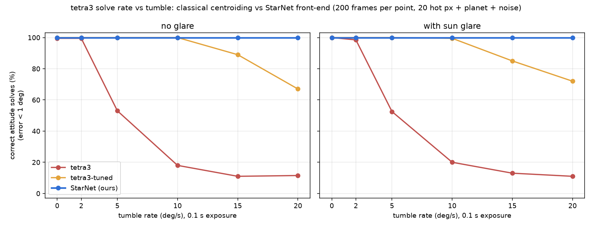

# ml/ — StarNet, the learned star front-end for tetra3

tetra3 (cedar-solve) identifies stars and solves attitude by geometric hashing:
no learning. Its weak point is the step before that, its threshold-based blob
finder. When the spacecraft tumbles, each star smears into a faint streak:
tetra3 throws streaks away (blob area cap), splits them into fragments, or loses
them in glare. StarNet replaces that step: a small CNN that takes the raw frame
and returns sub-pixel star centroids (mid-exposure position), brightest first.
It also labels the junk, so planets, hot pixels and glare never reach tetra3.



## Results (200 frames per cell, 2400 frames, `out/benchmark.md` has the full table)

Correct = tetra3 returned an attitude within 1° of truth. Each frame is
1920×1080, 50° FOV, 0.1 s exposure, read noise 2 DN, 20 hot pixels and a fake planet.

| tumble (deg/s) | 0 | 2 | 5 | 10 | 15 | 20 |
|---|---:|---:|---:|---:|---:|---:|
| tetra3 (default centroider), no glare | 99.5 | 99.5 | 53.0 | 18.0 | 11.0 | 11.5 |
| tetra3-tuned (`max_area=5000`), no glare | 100 | 100 | 100 | 100 | 89.0 | 67.0 |
| **StarNet → tetra3, no glare** | **100** | **100** | **100** | **100** | **100** | **100** |
| tetra3, glare | 100 | 98.5 | 52.5 | 20.0 | 13.0 | 11.0 |
| tetra3-tuned, glare | 100 | 100 | 100 | 99.5 | 85.0 | 72.0 |
| **StarNet → tetra3, glare** | **100** | **100** | **100** | **100** | **100** | **100** |

Median attitude error of correct solves at 20 deg/s: **~100″ with StarNet**,
versus 333″ for tuned tetra3 and 900–2100″ for default tetra3. At rest all three
give about 69″, which is the floor set by the database and the solver. StarNet
needs no special case at rest.

What the centroid metrics show (from `out/benchmark.md`):
* **Precision:** at 10–20 deg/s, 84–95% of StarNet's star centroids are real
  stars. For tetra3's blob finder it is 14–37%: it breaks every streak into
  several fragments. The tuned baseline also always passes the planet through
  as a "star" (junk 1.0 per frame). StarNet lets 0.1–0.3 junk objects per frame through.
* **Centroid error:** 0.3–0.66 px on streaks, versus 0.6–1.5 px classical.
* **Recall** stays around 0.6–0.7 for StarNet because `detect` deliberately returns only the 60
  brightest stars (frames contain about 100). That is all tetra3 needs, and it
  keeps faint candidates out of the solver.
* **Glare:** the simulator's glare is a smooth corner gradient. It barely hurts any
  method here, so glare is not yet the stress test it should be. Next step: add
  lens flare and ghost artifacts to `patches.py`.
* The absolute baseline numbers differ from the earlier 15-frame check (1/15 at
  5 deg/s), which used different noise and no hot pixels or planet. The
  shape of the result is the same.
* Speed: about 25 ms per frame on Apple MPS, so live use is fine. The benchmark's s/frame is
  single-threaded CPU inference (0.45 s for the net) plus tetra3's solve time.

## Files

| file | what |
|---|---|
| `patches.py` | synthetic labelled frames from `sim.sky`: random attitude, tumble 0–20 deg/s about a random axis, glare, 0–40 hot pixels, fake planet (extended, smeared), background and read noise. Labels come from geometry (`project` at mid-exposure), so they are exact. Also builds the dense training targets. |
| `model.py` | `StarNet` (470k params) + CenterNet focal loss |
| `train.py` | trains on an infinite stream of freshly rendered 256 px crops |
| `detect.py` | **`detect(img_u8) -> (centroids_yx, classes, scores)`**, the live-pipeline API |
| `benchmark.py` | tetra3 vs tuned tetra3 vs StarNet → tetra3, writes `out/solve_rate.png`, `out/benchmark.md`, `out/bench_frames.csv` |
| `viz.py` | `out/detect_example.png`: tetra3 blobs vs StarNet detections on one frame |
| `weights/starnet.pt` | trained weights (4000 steps × 32 crops, ~1.9 MB) |

## Design (why a heatmap net)

A "blob proposals + patch classifier" design would put a threshold-based proposal
step in front of the CNN, and that is exactly the step that fails on faint
streaks. So StarNet is a single fully convolutional CenterNet-style net (a small
U-Net down to stride 16 with dilated convs). Its receptive field is about 200 px,
wider than the 72 px streak at 20 deg/s, so it learns the streak matched filter
itself. At stride 4 it outputs:

* heatmaps for **star / planet / hot pixel** (peak = object centre)
* a sub-cell **offset** for sub-pixel centroids
* a **magnitude** estimate, used to sort stars brightest-first (tetra3 builds patterns from the brightest stars)
* a **glare** mask

**Background** is the absence of a peak. A frame with glare also gets one `glare`
detection at the glare region's centroid.

Training labels: a star is a positive when its matched-filter SNR (flux / noise /
√streak area, with headroom lost to 8-bit saturation under glare taken off) is ≥ 5.
Between 2.5 and 5 it is don't-care, so the net isn't punished for marginal stars.

## API

```python
from ml.detect import detect, star_centroids, CLASSES, STAR
yx, cls, score = detect(img_u8)          # yx in tetra3 convention (pixel-corner origin)
stars = yx[cls == STAR]                  # already brightest-first, max 60
res = t3.solve_from_centroids(stars, img_u8.shape, fov_estimate=50, fov_max_error=10)
```

`CLASSES = ["star", "planet", "glare", "hot_pixel", "background"]`. The input must
be in screen-pixel geometry (after the camera→screen homography warp), because the
net was trained at the renderer's scale: 1920×1080, 50° FOV, star σ 1.6–3.6 px.
Inference takes about 25 ms per 1920×1080 frame on Apple MPS and about 0.45 s on
CPU (it picks CUDA, then MPS, then CPU automatically).

## Run / retrain

```bash
.venv/bin/pip install torch matplotlib pandas      # CPU wheels are fine
.venv/bin/python -m ml.patches                     # preview of training frames -> ml/out/patches_preview.png
.venv/bin/python -m ml.train                       # ~16 min on Apple MPS (~60 min CPU-only); --steps 300 to smoke test
.venv/bin/python -m ml.benchmark                   # 200 frames/cell, ~25 min on 10 cores; --n 20 for a quick look
.venv/bin/python -m ml.viz --rate 10 --glare       # example picture
```

## Caveats

* Everything here is **simulated**: the same renderer generates both the training
  and the test frames (test seeds are disjoint). The webcam-on-screen path adds
  blur, rolling shutter, moiré and gamma. Before trusting these numbers on the
  real rig, fine-tune on a few hundred recorded frames, or add those effects to
  `patches.py`.
* The 0.1 s exposure is fixed in the benchmark; training uses 0.1 s too.
* "tetra3-tuned" is tetra3's own centroider with `max_area` raised from 100 to 5000.
  It is a one-line change, and it closes much of the gap. It is included so that
  the comparison is honest.
